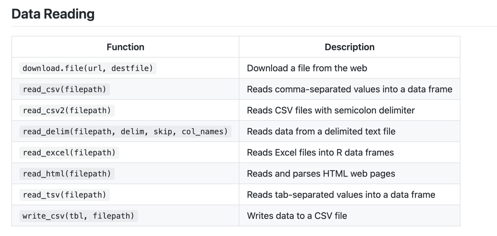
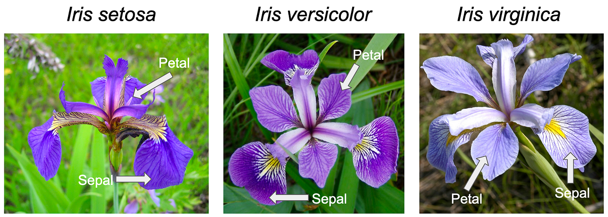

## Get ready to crush your midterm. {#welcome background-color="#fff4be"}

{height="96"}

Welcome to the DSCI100 study social. Everything here runs in your browser, so bring your questions and start coding.

## How to navigate this deck

::: {.cards .c3}
::: {.card}
[Move around]{.card-title}

<kbd>→</kbd> <kbd>←</kbd> next / previous slide

<kbd>Space</kbd> next
:::
::: {.card}
[Jump anywhere]{.card-title}

<kbd>M</kbd> or the ☰ button: **slide menu** with every slide listed

<kbd>Esc</kbd> or <kbd>O</kbd>: **overview grid**

<kbd>Home</kbd> / <kbd>End</kbd>: first / last
:::
::: {.card}
[Handy extras]{.card-title}

<kbd>F</kbd> fullscreen


<kbd>?</kbd> all keyboard shortcuts
:::
:::

::: {.callout-note title="Typing into a code cell?"}
Reveal shortcuts are paused while your cursor is inside a code editor. Click outside the editor to use the arrow keys again.
:::

## Tonight's roadmap

```{=html}
<div class="cards c3">
  <a class="card" href="#/s-strategy"><span class="n">01</span><h4>Strategy</h4><span class="d">Exam format, formula sheet, anatomy of a function</span></a>
  <a class="card" href="#/s-tidyverse"><span class="n">02</span><h4>Tidyverse functions</h4><span class="d">read, filter, select, arrange, slice, map, mutate, group_by, summarize</span></a>
  <a class="card" href="#/s-questions"><span class="n">03</span><h4>Questions &amp; tidy data</h4><span class="d">Types of questions &amp; answers, dataframes, file paths</span></a>
  <a class="card" href="#/s-viz"><span class="n">04</span><h4>Data visualization</h4><span class="d">Choosing, refining and explaining plots</span></a>
  <a class="card" href="#/s-db"><span class="n">05</span><h4>Databases</h4><span class="d">SQLite, PostgreSQL, tbl() and collect()</span></a>
  <a class="card" href="#/s-knn"><span class="n">06</span><h4>Classification &amp; K-NN</h4><span class="d">How K-NN works, tidymodels, scaling</span></a>
  <a class="card" href="#/s-git"><span class="n">07</span><h4>Version control</h4><span class="d">Git, GitHub, the four commands, merge conflicts</span></a>
  <a class="card" href="#/s-practice"><span class="n">08</span><h4>Wrap-up</h4><span class="d">Practice hub with all six exercises, next steps</span></a>
</div>
```

# Strategy {#s-strategy background-color="#a152a8"}

::: {.section-kicker}
Part 01
:::

Code & Concepts

## Let's strategize!

Data Science 100 is an introductory data science course. Its exams focus heavily on understanding **the theory behind the code**. We need to know the *why*, not just the *how*.

This is especially relevant because of **the format of the exam**. You do not have access to a code editor. Don't stress about that too hard. **This is to your advantage!**

## Using the formula sheet

- Coding questions on this exam, if/when they appear, are almost always **fill-in-the-blank**.
- You'll get a **formula sheet** that is super useful and comprehensive.
- Code questions are **auto-graded**. Even if you are somewhat sure of your answer, copy and paste from the formula sheet to avoid typos and errors.

::: {.fragment}
::: {.callout-tip title="Pro move"}
**<kbd>Cmd</kbd>/<kbd>Ctrl</kbd> + <kbd>F</kbd>** the formula sheet. Whether the question is multiple choice, fill-in-the-blank, or short answer, search for the function name or a keyword from the question.
:::
:::

## Anatomy of a function

We can generally define a function as something that...

<div class="flow">
  <div class="step"><b>gets information</b>arguments go in</div>
  <div class="arrow">→</div>
  <div class="step"><b>does something</b>with that information</div>
  <div class="arrow">→</div>
  <div class="step"><b>returns something new</b>a value, vector or dataframe</div>
</div>

## The formula sheet and functions

::: {.columns}
::: {.column width="58%"}
{fig-align="center"}
:::
::: {.column width="42%"}
Every row of the formula sheet has the same anatomy:

- **Function name** : how to call the function
- **Arguments** (inside the brackets): what information the function gets
- **Description**: what the function does *and returns*

::: {.small-text .muted}
Read the description first. It tells you what comes out, which is usually what the question is really asking.
:::
:::
:::

# Tidyverse functions {#s-tidyverse background-color="#0e2a47"}

::: {.section-kicker}
Part 02
:::

`library(tidyverse)`

## Meet the data: `iris`

::: {.columns}
::: {.column width="62%"}
For the practice exercises we'll use `iris`, a dataset that ships with base R. It has four measurements of two flower parts (sepal and petal) for three iris species.

```{webr-r}
#| autorun: true
## Run this cell before continuing!
library(tidyverse)
data(iris)
glimpse(iris)
head(iris)
```
:::
::: {.column width="38%"}
{fig-align="center"}
:::
:::

## Reading data

- `read_csv()`, `read_csv2()`, `read_tsv()`; `read_delim()` for custom delimiters
- Can read from **file paths or URLs**. Pass them as a **string** (in quotes!)
- Useful arguments: `col_names = FALSE`, `skip = n`
- Read Excel files with `library(readxl)` and `read_excel()`

```r
library(tidyverse)
read_csv("path/or/url/to/data.csv", skip = 2, col_names = FALSE)
```

## `filter()` vs `select()`

::: {.columns}
::: {.column width="30%"}
- `filter()` → chooses **rows**
- `select()` → chooses **columns**

**Common filter operators** (find them on your formula sheet!)

- `==`, `!=`
- `>`, `<`, `>=`, `<=`
- `|` (OR)
- `%in%` (matches any value in a vector)
:::
::: {.column width="70%"}
**Try it**

```{webr-r}
iris |>
  filter(Species == "virginica", Sepal.Length > 7) |>
  select(Sepal.Length, Species)
```
:::
:::

## Anatomy of `filter()` and `select()`

::: {.cards .c3}
::: {.card}
[What do they get?]{.card-title}

Both receive a **dataframe**, plus some additional information (a condition, or column names).
:::
::: {.card}
[What do they do?]{.card-title}

They specify the data of interest. `select()` chooses individual **columns**; `filter()` chooses **rows** that match a condition.
:::
::: {.card}
[What do they return?]{.card-title}

A dataframe that is **smaller** than the original.
:::
:::

## `filter()` and `select()` in action {#anim-fs}

```{=html}
<div class="anim a-fs">
  <div class="codebar">iris |&gt; <span class="k k1">filter(Species == "virginica")</span> |&gt; <span class="k k2">select(Species, Petal.Length)</span></div>
  <div class="tbl">
    <div class="r h"><div class="c kc">Species</div><div class="c dc">Sepal.Length</div><div class="c kc">Petal.Length</div><div class="c dc">Petal.Width</div></div>
    <div class="r drop"><div class="c kc">setosa</div><div class="c dc">5.1</div><div class="c kc">1.4</div><div class="c dc">0.2</div></div>
    <div class="r keep"><div class="c kc">virginica</div><div class="c dc">6.3</div><div class="c kc">6.0</div><div class="c dc">2.5</div></div>
    <div class="r drop"><div class="c kc">versicolor</div><div class="c dc">7.0</div><div class="c kc">4.7</div><div class="c dc">1.4</div></div>
    <div class="r keep"><div class="c kc">virginica</div><div class="c dc">5.8</div><div class="c kc">5.1</div><div class="c dc">1.9</div></div>
    <div class="r keep"><div class="c kc">virginica</div><div class="c dc">7.1</div><div class="c kc">5.9</div><div class="c dc">2.1</div></div>
  </div>
  <div class="caps">
    <div class="cap cap1"><span>Start: the whole table</span></div>
    <div class="cap cap2"><span><b>filter()</b> keeps the <b>rows</b> that match</span></div>
    <div class="cap cap3"><span><b>select()</b> keeps the <b>columns</b> you name</span></div>
    <div class="cap cap4"><span>Result: fewer rows <b>and</b> fewer columns</span></div>
  </div>
  <button class="btn replay" onclick="qReplay(this)">↻ Replay</button>
</div>
```

## `arrange()` and `slice()`

::: {.columns}
::: {.column width="30%"}
- `arrange()` orders rows by column values
- `slice()` selects rows by row number or range: `slice(1)`, `slice(5)`, `slice(1:5)`
- Used together to get the **top of a dataset** arranged by some value (e.g. highest exam score, then return the top student)
- Both get a dataframe and return a dataframe
:::
::: {.column width="70%"}
**Try it**: top 3 longest petals

```{webr-r}
iris |>
  arrange(desc(Petal.Length)) |>
  slice(1:3)
```
:::
:::

## `map()`

::: {.columns}
::: {.column width="30%"}
**What does it get?** A dataframe and a function.

**What does it do?** Applies a function to many columns.

**What does it return?** `map()` always returns a **list**. Use `map_df()` to get a tibble back.
:::
::: {.column width="70%"}
**Try it**: mean of every numeric column

```{webr-r}
iris |>
  select(where(is.numeric)) |>
  map_df(mean)
```
:::
:::

## `map_df()` in action {#anim-map}

```{=html}
<div class="anim a-map">
  <div class="codebar">iris |&gt; select(where(is.numeric)) |&gt; <span class="k k1">map_df(mean)</span></div>
  <div class="mcols">
    <div class="mcol m1"><div class="fnb">mean()</div><div class="mh">Sepal.Length</div><div class="vals"><div>5.1</div><div>4.9</div><div>4.7</div><div>5.3</div></div><div class="arr">▼</div><div class="res">5.0</div></div>
    <div class="mcol m2"><div class="fnb">mean()</div><div class="mh">Sepal.Width</div><div class="vals"><div>3.5</div><div>3.0</div><div>3.2</div><div>3.3</div></div><div class="arr">▼</div><div class="res">3.25</div></div>
    <div class="mcol m3"><div class="fnb">mean()</div><div class="mh">Petal.Length</div><div class="vals"><div>1.4</div><div>1.4</div><div>1.3</div><div>1.5</div></div><div class="arr">▼</div><div class="res">1.4</div></div>
  </div>
  <div class="caps">
    <div class="cap cap1"><span>Each column is a set of numbers</span></div>
    <div class="cap cap2"><span><b>map_df()</b> hands every column to <b>mean()</b></span></div>
    <div class="cap cap3"><span>One result per column, returned as a <b>tibble</b></span></div>
  </div>
  <button class="btn replay" onclick="qReplay(this)">↻ Replay</button>
</div>
```

## `mutate()`

::: {.columns}
::: {.column width="30%"}
`mutate()` creates **new columns** using existing columns, e.g. `mutate(area = width * height)`.

It gets a dataframe, does whatever you tell it to, and returns **the whole dataframe you gave it, plus the new column**.
:::
::: {.column width="70%"}
**Try it**

```{webr-r}
iris |>
  mutate(Petal.Ratio = Petal.Length / Petal.Width) |>
  select(Species, Petal.Length, Petal.Width, Petal.Ratio) |>
  head()
```
:::
:::

## `mutate()` in action {#anim-mut}

```{=html}
<div class="anim a-mut">
  <div class="codebar">flowers |&gt; <span class="k k1">mutate(area = Length * Width)</span></div>
  <div class="tbl">
    <div class="r h"><div class="c">Length</div><div class="c">Width</div><div class="c nc">area</div></div>
    <div class="r"><div class="c">2</div><div class="c">3</div><div class="c nc"><span class="f1">2 × 3</span><span class="f2">6</span></div></div>
    <div class="r"><div class="c">4</div><div class="c">5</div><div class="c nc"><span class="f1">4 × 5</span><span class="f2">20</span></div></div>
    <div class="r"><div class="c">1</div><div class="c">7</div><div class="c nc"><span class="f1">1 × 7</span><span class="f2">7</span></div></div>
    <div class="r"><div class="c">3</div><div class="c">3</div><div class="c nc"><span class="f1">3 × 3</span><span class="f2">9</span></div></div>
  </div>
  <div class="caps">
    <div class="cap cap1"><span>Start with two columns</span></div>
    <div class="cap cap2"><span><b>mutate()</b> builds a new column from existing ones</span></div>
    <div class="cap cap3"><span>Everything you started with is still there, <b>plus</b> the new column</span></div>
  </div>
  <button class="btn replay" onclick="qReplay(this)">↻ Replay</button>
</div>
```

## Exercise 2: Filter, select, mutate, arrange, slice {#ex2 .scrollable}

::: {.ex-box}
Using `iris` and the tidyverse, complete the four steps and assign your work to **`iris_wrangled`**.

1. **Filter** for rows where `Species` is "virginica" and `Sepal.Length` is greater than 6
2. **Select** only `Sepal.Length`, `Sepal.Width`, and `Species`
3. **Mutate** a new column `Sepal.Area` = Length × Width
4. **Arrange** by `Sepal.Area` in descending order and **slice** to return 3 rows
:::

```{webr-r}
## YOUR CODE HERE!
# iris_wrangled <- iris |>
#   filter(...) |>
#   select(...) |>
#   mutate(...) |>
#   arrange(...) |>
#   slice(...)
```

<details class="solution">
<summary>Show solution</summary>

```r
iris_wrangled <- iris |>
  filter(Species == "virginica", Sepal.Length > 6) |>
  select(Sepal.Length, Sepal.Width, Species) |>
  mutate(Sepal.Area = Sepal.Length * Sepal.Width) |>
  arrange(desc(Sepal.Area)) |>
  slice(1:3)

iris_wrangled
```

**Heads up:** after `arrange(desc(...))` the biggest areas come first, so `slice(1:3)` returns the 3 *largest*. For the 3 *smallest*, arrange ascending (drop `desc()`) and keep `slice(1:3)`.

</details>

## `group_by()` and `summarize()`

Last semester, lots of students found these two functions quite confusing!

They're used together in this course, but they're easier to understand when we look at their **anatomy separately**.

## `group_by()`

::: {.cards .c3}
::: {.card}
[What does it get?]{.card-title}

A dataframe, and a column that specifies which **categories** to group your data by.
:::
::: {.card}
[What does it do?]{.card-title}

Puts your data into different groups using **metadata**.
:::
::: {.card}
[What does it return?]{.card-title}

What looks like the **exact same dataframe**. To the naked eye, `group_by()` does nothing on its own.
:::
:::

## Visualizing `group_by()`

```{=html}
<div class="row-flex">
  <div>
    <table class="df"><thead><tr><th>species</th><th>height</th></tr></thead><tbody>
      <tr><td>giraffe</td><td>500 cm</td></tr>
      <tr><td>ant</td><td>0.02 cm</td></tr>
      <tr><td>ant</td><td>0.01 cm</td></tr>
      <tr><td>giraffe</td><td>400 cm</td></tr>
      <tr><td>giraffe</td><td>300 cm</td></tr>
    </tbody></table>
    <div class="dfcap"><code>animals</code></div>
  </div>
  <div class="arrow-big fragment" data-fragment-index="1">→</div>
  <div class="fragment" data-fragment-index="1">
    <table class="df"><thead><tr><th>species</th><th>height</th></tr></thead><tbody>
      <tr class="g"><td>giraffe</td><td>500 cm</td></tr>
      <tr class="a"><td>ant</td><td>0.02 cm</td></tr>
      <tr class="a"><td>ant</td><td>0.01 cm</td></tr>
      <tr class="g"><td>giraffe</td><td>400 cm</td></tr>
      <tr class="g"><td>giraffe</td><td>300 cm</td></tr>
    </tbody></table>
    <div class="dfcap"><code>animals |&gt; group_by(species)</code></div>
  </div>
</div>
```

::: {.fragment}
Same rows, same values, but R now remembers **two groups**: <span class="chip-y">giraffe</span> and <span class="chip-m">ant</span>.
:::

## `summarize()`

::: {.cards .c3}
::: {.card}
[What does it get?]{.card-title}

A dataframe, **grouped or ungrouped**.
:::
::: {.card}
[What does it do?]{.card-title}

Calculates summary statistics, e.g. `summarize(mean_height = mean(height))`. If the data is grouped, it runs **once per group**; otherwise on the whole dataframe.
:::
::: {.card}
[What does it return?]{.card-title}

An **entirely new dataframe** containing only the summaries you asked for.
:::
:::

## Visualizing `summarize()`

```{=html}
<div class="row-flex">
  <div>
    <table class="df"><thead><tr><th>species</th><th>height</th></tr></thead><tbody>
      <tr><td>giraffe</td><td>500 cm</td></tr>
      <tr><td>ant</td><td>0.02 cm</td></tr>
      <tr><td>ant</td><td>0.01 cm</td></tr>
      <tr><td>giraffe</td><td>400 cm</td></tr>
      <tr><td>giraffe</td><td>300 cm</td></tr>
    </tbody></table>
  </div>
  <div class="arrow-big">→</div>
  <div>
    <table class="df"><thead><tr><th>mean_height</th></tr></thead><tbody>
      <tr><td style="text-align:center">240.006</td></tr>
    </tbody></table>
  </div>
</div>
<div class="dfcap" style="font-size:.7em"><code>animal_stats &lt;- animals |&gt; summarize(mean_height = mean(height))</code></div>
```

## Visualizing `group_by() |> summarize()`

```{=html}
<div class="row-flex">
  <div>
    <table class="df"><thead><tr><th>species</th><th>height</th></tr></thead><tbody>
      <tr class="g"><td>giraffe</td><td>500 cm</td></tr>
      <tr class="a"><td>ant</td><td>0.02 cm</td></tr>
      <tr class="a"><td>ant</td><td>0.01 cm</td></tr>
      <tr class="g"><td>giraffe</td><td>400 cm</td></tr>
      <tr class="g"><td>giraffe</td><td>300 cm</td></tr>
    </tbody></table>
  </div>
  <div class="arrow-big">→</div>
  <div class="fragment">
    <table class="df"><thead><tr><th>species</th><th>mean_height</th></tr></thead><tbody>
      <tr class="g"><td>giraffe</td><td>400 cm</td></tr>
      <tr class="a"><td>ant</td><td>0.015 cm</td></tr>
    </tbody></table>
  </div>
</div>
<div class="dfcap" style="font-size:.7em"><code>animal_stats &lt;- animals |&gt; group_by(species) |&gt; summarize(mean_height = mean(height))</code></div>
```

::: {.fragment}
One row **per group**, and only the columns you asked for.
:::

## Try it: `group_by() |> summarize()`

```{webr-r}
animals <- tibble(
  species = c("giraffe", "ant", "ant", "giraffe", "giraffe"),
  height  = c(500, 0.02, 0.01, 400, 300)
)

# 1. Summarize the whole dataframe
animals |> summarize(mean_height = mean(height))

# 2. Now group first. What changes?
# animals |>
#   group_by(species) |>
#   summarize(mean_height = mean(height))
```

::: {.small-text .muted}
Uncomment part 2 and run again. Also try adding `n = n()` inside `summarize()`.
:::

## Exercise 3: Group by and summarize {#ex3 .scrollable}

::: {.ex-box}
Find the **mean sepal length** for each species of iris. Assign your answer to an object called **`mean_sepal_length`**.
:::

```{webr-r}
## YOUR CODE HERE!
# mean_sepal_length <- ... |>
#   ...(...) |>
#   ...(mean_sepal_length = ...)
```

<details class="solution">
<summary>Show solution</summary>

```r
mean_sepal_length <- iris |>
  group_by(Species) |>
  summarize(mean_sepal_length = mean(Sepal.Length))

mean_sepal_length
```

</details>

## Questions? {#questions-slide}

# Questions & tidy data {#s-questions background-color="#e8afc0"}

::: {.section-kicker}
Part 03
:::

Code & Concepts

## Types of questions

::: {.columns}
::: {.column width="78%"}
- **Descriptive**: summarized characteristics, without interpretation; supplies facts
- **Exploratory**: is there a trend? Used to propose a hypothesis
- **Predictive**: predicts measurements or labels
- **Inferential**: looks for trends and quantifies how applicable the trend is to the wider population
- **Causal**: will changing one factor change another?
- **Mechanistic**: how does a relationship happen?
:::
::: {.column width="22%"}

:::
:::

## Types of answers

- **Summarization**: aggregated values (means, medians, counts)
- **Visualization**: graphical representations to explore patterns
- **Classification**: predicting categories (labels)
- **Regression**: predicting numerical values
- **Clustering**: finding unknown subgroups
- **Estimation**: inferring population values from a sample

## Exercise 1: Question classification {#ex1 .scrollable}

::: {.ex-box}
Match each question about the `iris` dataset to its type: **Descriptive, Exploratory, Predictive, Inferential, Causal, Mechanistic**.
:::

```{=html}
<div class="quiz" id="ex1-quiz">
  <div class="q" data-answer="Descriptive"><span>"What is the average petal length for each species in this specific dataset?"</span><select></select><span class="mark"></span></div>
  <div class="q" data-answer="Predictive"><span>"Can we use sepal width to predict which species a flower belongs to?"</span><select></select><span class="mark"></span></div>
  <div class="q" data-answer="Causal"><span>"If we increase the nitrogen in the soil, will it cause the petals to grow longer?"</span><select></select><span class="mark"></span></div>
  <div class="q" data-answer="Exploratory"><span>"Is there a correlation between sepal length and petal length that suggests a hypothesis?"</span><select></select><span class="mark"></span></div>
</div>
<div class="quiz-btns">
  <button class="btn" onclick="ex1Check()">Check answers</button>
  <button class="btn" onclick="ex1Reveal()">Reveal answers</button>
  <button class="btn" onclick="ex1Reset()">Reset</button>
  <span class="quiz-score" id="ex1score"></span>
</div>
<script>
(function(){
  var types = ["Descriptive","Exploratory","Predictive","Inferential","Causal","Mechanistic"];
  function qs(){ return document.querySelectorAll("#ex1-quiz .q"); }
  function fill(){
    qs().forEach(function(q){
      var sel = q.querySelector("select");
      if (sel.options.length) return;
      var o = document.createElement("option"); o.value = ""; o.textContent = "Choose a type…"; sel.appendChild(o);
      types.forEach(function(t){ var op = document.createElement("option"); op.value = t; op.textContent = t; sel.appendChild(op); });
    });
  }
  fill();
  window.ex1Check = function(){
    var ok = 0;
    qs().forEach(function(q){
      var v = q.querySelector("select").value, m = q.querySelector(".mark");
      q.classList.remove("ok","bad");
      if (!v) { m.textContent = ""; return; }
      if (v === q.dataset.answer) { q.classList.add("ok"); m.textContent = "✓"; ok++; }
      else { q.classList.add("bad"); m.textContent = "✗"; }
    });
    document.getElementById("ex1score").textContent = ok + " / " + qs().length + " correct";
  };
  window.ex1Reveal = function(){
    qs().forEach(function(q){ q.querySelector("select").value = q.dataset.answer; });
    window.ex1Check();
  };
  window.ex1Reset = function(){
    qs().forEach(function(q){ q.querySelector("select").value = ""; q.classList.remove("ok","bad"); q.querySelector(".mark").textContent = ""; });
    document.getElementById("ex1score").textContent = "";
  };
})();
</script>
```

## Understanding dataframes: tidy data

::: {.columns}
::: {.column width="55%"}
```{=html}
<table class="df" style="font-size:.95em">
  <thead><tr><th class="col">species</th><th class="col">height</th></tr></thead>
  <tbody>
    <tr class="row"><td>giraffe</td><td>500 cm</td></tr>
    <tr><td>ant</td><td>0.02 cm</td></tr>
    <tr><td>ant</td><td class="val">0.01 cm</td></tr>
    <tr><td>giraffe</td><td>400 cm</td></tr>
    <tr><td>giraffe</td><td>300 cm</td></tr>
  </tbody>
</table>
```
:::
::: {.column width="45%"}
### Tidy data principles

- <span class="hl">**Rows**</span> = observations
- <span class="hl2">**Columns**</span> = variables
- <span class="hl3">**Values**</span> = individual measurements
:::
:::

## Why tidy data?

::: {.center}
Consistent structure

Works with tidyverse functions

Easier to understand and analyze
:::

## File paths

::: {.columns}
::: {.column width="78%"}
**Absolute paths**

- Start with `/`
- Machine-specific
- Error-prone, long, and **not portable**

**Relative paths** (preferred)

- Relative to the current working directory
- Use `.` (current) and `..` (parent)
- Portable and shorter, so use these instead!
:::
::: {.column width="22%"}

:::
:::

# Data visualization {#s-viz background-color="#aed8c8"}

::: {.section-kicker}
Part 04
:::

Choose it · refine it · explain it

## Choosing a visualization

::: {.columns}
::: {.column width="58%"}
- **Scatter plot** → relationship between two quantitative variables
- **Line plot** → trends over an ordered variable (e.g. time)
- **Bar plot** → compare amounts
- **Histogram** → distribution of one quantitative variable
:::
::: {.column width="42%"}
**Avoid...**

- Pie charts
- 3D plots
- Tables for numerical comparison
:::
:::

## Refining visualizations

- Clear **labels and legends**
- **Colorblind-friendly** colors
- Avoid **overplotting**
- Minimize visual noise
- Don't manipulate axes to exaggerate differences
- Redundancy helps understanding!

## Explaining visualizations

::: {.columns}
::: {.column width="50%"}
1. Set **context and scope**
2. State the **question**
3. **Answer** using the visualization
4. Describe:
   - Trends
   - Spread and center
   - Relationships
   - Group differences
5. End with a clear **takeaway**
:::
::: {.column width="50%"}
::: {.callout-tip title="Practice this next"}
In the next exercise, make the plot, then try explaining it out loud using these five steps.
:::
:::
:::

## Exercise 4: Visualization! {#ex4 .scrollable}

::: {.ex-box}
Create a **scatter plot** of `Petal.Length` (x) vs `Petal.Width` (y). **Color the points by Species.** Use human-readable labels and give your plot a title. Assign your answer to **`iris_scatter`**.
:::

```{webr-r}
## YOUR CODE HERE!
# iris_scatter <- ggplot(iris, aes(...)) +
#   geom_...() +
#   labs(...)

# iris_scatter
```

<details class="solution">
<summary>Show solution</summary>

```r
iris_scatter <- ggplot(iris, aes(x = Petal.Length, y = Petal.Width, color = Species)) +
  geom_point(alpha = 0.7) +
  labs(title = "Iris Petal Dimensions",
       x = "Petal Length (cm)",
       y = "Petal Width (cm)")

iris_scatter
```

</details>

Wow, don't those look like clear clusters to you?

# Databases {#s-db background-color="#fff4be"}

::: {.section-kicker}
Part 05
:::

Using databases, the `tbl()` function, and SQL

## SQLite vs PostgreSQL

::: {.cards .c2}
::: {.card}
[SQLite databases]{.card-title}

- Lightweight, file-based (`.db`)
- Efficient for large datasets
:::
::: {.card}
[PostgreSQL databases]{.card-title}

- Client–server database system
- Used over networks
- Same workflow as SQLite, but uses `RPostgres`
- Requires more connection arguments
:::
:::

## Working with a database

::: {.columns}
::: {.column width="45%"}
1. Connect using `dbConnect()`
2. List tables with `dbListTables()`
3. Use `tbl()` to query data
4. Bring data into R with `collect()`

**Key idea**

- `tbl()` translates R code into the associated **SQL** (structured query language) queries
- The data stays **in the database** until `collect()` is run
:::
::: {.column width="55%"}
```r
library(DBI)
con <- dbConnect(RSQLite::SQLite(), "my_data.db")

dbListTables(con)

my_tbl <- tbl(con, "table_name")   # still in the DB

my_tbl |>
  filter(...) |>
  collect()                         # now it's in R
```

::: {.tiny-text}
`my_data.db` and `table_name` are placeholders. Use the names from your question.
:::
:::
:::

## Why use databases?

- Handle **large datasets** efficiently
- **Data integrity** and access control
- **Multiple users** can work simultaneously
- Built-in **backups and security**

# Classification & K-NN {#s-knn background-color="#a152a8"}

::: {.section-kicker}
Part 06
:::

Predicting a category from its neighbours

## K-nearest neighbours

Recall our types of questions. K-NN is a **classification** problem, for which we ask **predictive** questions.

**How does it work?** Our goal is to predict a *categorical label*, using some features to assign a class.

1. Compute **distances** to the training points (straight-line distance)
2. **Sort** all the points around us by distance
3. Select the **K nearest** neighbours
4. Predict the class of the new observation by **majority vote**!

## K-NN in action {#anim-knn-what}

```{=html}
<div class="anim kn3">
  <div class="codebar">nearest_neighbor(weight_func = "rectangular", <span class="k k1">neighbors = 3</span>)</div>
  <svg viewBox="0 0 640 350" role="img" aria-label="Animation: K-NN finds the 3 nearest neighbours and takes a majority vote">
    <rect x="2" y="2" width="636" height="346" rx="16" fill="#fff" stroke="#0e2a47" stroke-width="3"/>
    <g class="hood-g"><circle class="hood" cx="330" cy="175" r="97" fill="rgba(161,82,168,.10)" stroke="#a152a8" stroke-width="3" stroke-dasharray="8 6"/></g>
    <g class="lines-far"><line x1="330" y1="175" x2="200" y2="130" class="dl" style="animation-delay:3.6s"/><line x1="330" y1="175" x2="150" y2="230" class="dl" style="animation-delay:3.8s"/><line x1="330" y1="175" x2="235" y2="85" class="dl" style="animation-delay:4.0s"/><line x1="330" y1="175" x2="120" y2="150" class="dl" style="animation-delay:4.2s"/><line x1="330" y1="175" x2="420" y2="140" class="dl" style="animation-delay:4.6s"/><line x1="330" y1="175" x2="485" y2="105" class="dl" style="animation-delay:4.8s"/><line x1="330" y1="175" x2="510" y2="215" class="dl" style="animation-delay:5.0s"/><line x1="330" y1="175" x2="450" y2="275" class="dl" style="animation-delay:5.2s"/><line x1="330" y1="175" x2="560" y2="160" class="dl" style="animation-delay:5.4s"/></g>
    <g class="lines-near"><line x1="330" y1="175" x2="290" y2="150" class="dl" style="animation-delay:3.2s"/><line x1="330" y1="175" x2="255" y2="210" class="dl" style="animation-delay:3.4s"/><line x1="330" y1="175" x2="385" y2="205" class="dl" style="animation-delay:4.4s"/></g>
    <g class="pts-far"><g><circle cx="200" cy="130" r="12" fill="#e8afc0" stroke="#0e2a47" stroke-width="3"/><text x="200" y="135" font-size="14" text-anchor="middle">A</text></g><g><circle cx="150" cy="230" r="12" fill="#e8afc0" stroke="#0e2a47" stroke-width="3"/><text x="150" y="235" font-size="14" text-anchor="middle">A</text></g><g><circle cx="235" cy="85" r="12" fill="#e8afc0" stroke="#0e2a47" stroke-width="3"/><text x="235" y="90" font-size="14" text-anchor="middle">A</text></g><g><circle cx="120" cy="150" r="12" fill="#e8afc0" stroke="#0e2a47" stroke-width="3"/><text x="120" y="155" font-size="14" text-anchor="middle">A</text></g><g><circle cx="420" cy="140" r="12" fill="#aed8c8" stroke="#0e2a47" stroke-width="3"/><text x="420" y="145" font-size="14" text-anchor="middle">B</text></g><g><circle cx="485" cy="105" r="12" fill="#aed8c8" stroke="#0e2a47" stroke-width="3"/><text x="485" y="110" font-size="14" text-anchor="middle">B</text></g><g><circle cx="510" cy="215" r="12" fill="#aed8c8" stroke="#0e2a47" stroke-width="3"/><text x="510" y="220" font-size="14" text-anchor="middle">B</text></g><g><circle cx="450" cy="275" r="12" fill="#aed8c8" stroke="#0e2a47" stroke-width="3"/><text x="450" y="280" font-size="14" text-anchor="middle">B</text></g><g><circle cx="560" cy="160" r="12" fill="#aed8c8" stroke="#0e2a47" stroke-width="3"/><text x="560" y="165" font-size="14" text-anchor="middle">B</text></g></g>
    <g class="pts-near"><g><circle cx="290" cy="150" r="12" fill="#e8afc0" stroke="#0e2a47" stroke-width="3"/><text x="290" y="155" font-size="14" text-anchor="middle">A</text></g><g><circle cx="255" cy="210" r="12" fill="#e8afc0" stroke="#0e2a47" stroke-width="3"/><text x="255" y="215" font-size="14" text-anchor="middle">A</text></g><g><circle cx="385" cy="205" r="12" fill="#aed8c8" stroke="#0e2a47" stroke-width="3"/><text x="385" y="210" font-size="14" text-anchor="middle">B</text></g></g>
    <text class="rank" x="256" y="134" font-size="15" style="animation-delay:7.2s">1st</text><text class="rank" x="403" y="189" font-size="15" style="animation-delay:7.7s">2nd</text><text class="rank" x="221" y="194" font-size="15" style="animation-delay:8.2s">3rd</text>
    <g class="pnew"><path d="M330,160 L345,175 L330,190 L315,175Z" fill="#a152a8" stroke="#0e2a47" stroke-width="3"/><text x="330" y="208" font-size="14" text-anchor="middle">new</text></g>
    <g class="tally"><rect x="28" y="26" width="210" height="34" rx="17" fill="#fff4be" stroke="#0e2a47" stroke-width="3"/><text x="133" y="48" font-size="15" text-anchor="middle">votes: A 2, B 1</text></g>
    <g class="verdict"><rect x="28" y="66" width="210" height="34" rx="17" fill="#e8afc0" stroke="#0e2a47" stroke-width="3"/><text x="133" y="88" font-size="15" text-anchor="middle">prediction: A</text></g>
  </svg>
  <div class="caps">
    <div class="cap cap1"><span>A <b>new observation</b> arrives. Which class is it?</span></div>
    <div class="cap cap2"><span><b>1.</b> Compute the distance to every training point</span></div>
    <div class="cap cap3"><span><b>2.</b> Sort by distance and keep the <b>K = 3</b> nearest</span></div>
    <div class="cap cap4"><span><b>3.</b> The majority vote decides: 2 votes for A beats 1 for B</span></div>
  </div>
  <button class="btn replay" onclick="qReplay(this)">↻ Replay</button>
</div>
```

## K-NN with `tidymodels`

1. Load `tidymodels`
2. Select predictors
3. Create the model with `nearest_neighbor()`
4. Fit the model with `fit()`
5. Predict with `predict()`

::: {.callout-note title="Use your reference sheet!"}
The formula sheet has the full recipe → workflow → fit → predict pipeline. Search for `nearest_neighbor`.
:::

## K-NN: centering & scaling

**What problem are we fixing?**

- Variables can be on very different scales, e.g. age (0–100) vs income (0–100,000)
- Distance-based models (like K-NN) treat **larger numbers as more important**
- This distorts similarity calculations

::: {.fragment}
After **centering and scaling** (standardization), all variables contribute fairly to the distance calculation, and therefore fairly to our classification.
:::

## Centering & scaling in action {#anim-knn}

```{=html}
<div class="anim knn">
  <div class="codebar">recipe(Class ~ age + income, data) |&gt; <span class="k k1">step_center(all_predictors())</span> |&gt; <span class="k k2">step_scale(all_predictors())</span></div>
  <svg viewBox="0 0 640 350" role="img" aria-label="Animation: K-NN distances before and after centering and scaling">
    <rect x="2" y="2" width="636" height="346" rx="16" fill="#fff" stroke="#0e2a47" stroke-width="3"/>
    <g class="axraw">
      <line x1="100" y1="30" x2="100" y2="335" stroke="#0e2a47" stroke-width="2.5"/>
      <line x1="100" y1="335" x2="560" y2="335" stroke="#0e2a47" stroke-width="2.5"/>
      <text x="108" y="26" font-size="15">income ($)</text>
      <text x="470" y="326" font-size="15">age (years)</text>
    </g>
    <g class="cross" stroke="#0e2a47" stroke-width="2" stroke-dasharray="3 6" opacity="0">
      <line x1="320" y1="24" x2="320" y2="334"/><line x1="40" y1="190" x2="600" y2="190"/>
    </g>
    <g class="ttl2">
      <text x="328" y="40" font-size="15">income (standardised)</text>
      <text x="440" y="182" font-size="15">age (standardised)</text>
    </g>
    <g class="raw-lines">
      <line x1="143.6" y1="280.0" x2="143.7" y2="100.0" stroke="#0e2a47" stroke-width="3" stroke-dasharray="7 6"/><line x1="143.6" y1="280.0" x2="146.6" y2="260.0" stroke="#0e2a47" stroke-width="3" stroke-dasharray="7 6"/><circle cx="146.6" cy="260.0" r="19" fill="none" stroke="#a152a8" stroke-width="4"/>
      <text x="162" y="196" font-size="17">distance 18,000</text>
      <text x="184" y="256" font-size="17">distance 2,000</text>
      <text x="184" y="278" font-size="15">nearest = B</text>
    </g>
    <g class="s2-lines">
      <line x1="245.0" y1="212.5" x2="252.5" y2="131.5" stroke="#0e2a47" stroke-width="3" stroke-dasharray="7 6"/><line x1="245.0" y1="212.5" x2="432.5" y2="203.5" stroke="#0e2a47" stroke-width="3" stroke-dasharray="7 6"/><circle cx="252.5" cy="131.5" r="19" fill="none" stroke="#a152a8" stroke-width="4"/>
      <text x="238" y="176" font-size="17" text-anchor="end">distance 0.90</text>
      <text x="300" y="240" font-size="17">distance 2.09</text>
      <text x="280" y="124" font-size="15">nearest = A</text>
    </g>
    <g class="p pn"><path d="M0,-14 L14,0 L0,14 L-14,0Z" fill="#a152a8" stroke="#0e2a47" stroke-width="3"/><text x="-20" y="5" font-size="14" text-anchor="end">new</text></g>
    <g class="p pa"><circle r="13" fill="#e8afc0" stroke="#0e2a47" stroke-width="3"/><text y="5" font-size="14" text-anchor="middle">A</text></g>
    <g class="p pb"><circle r="13" fill="#aed8c8" stroke="#0e2a47" stroke-width="3"/><text y="5" font-size="14" text-anchor="middle">B</text></g>
    <g class="v v1"><rect x="448" y="44" width="170" height="34" rx="17" fill="#fff4be" stroke="#0e2a47" stroke-width="3"/><text x="533" y="66" font-size="15" text-anchor="middle">raw: predicts B</text></g>
    <g class="v v2"><rect x="448" y="44" width="170" height="34" rx="17" fill="#e8afc0" stroke="#0e2a47" stroke-width="3"/><text x="533" y="66" font-size="15" text-anchor="middle">scaled: predicts A</text></g>
  </svg>
  <div class="caps">
    <div class="cap cap1"><span>Raw units: income is in the tens of thousands, age in tens, so <b>income swamps</b> the distance</span></div>
    <div class="cap cap2"><span><b>Centering:</b> subtract each mean (age 40, income $55,000)</span></div>
    <div class="cap cap3"><span><b>Scaling:</b> divide by each spread (12 years, $20,000)</span></div>
    <div class="cap cap4"><span>Fair distances: the nearest neighbour is now <b>A</b>, not B</span></div>
  </div>
  <button class="btn replay" onclick="qReplay(this)">↻ Replay</button>
</div>
```

## Exercise 5: Classification with K-NN {#ex5 .scrollable}

::: {.ex-box}
Last week I found a new, pretty iris and measured its petals. **What species is it?** Use K-NN with `Petal.Length` and `Petal.Width` as predictors and **3 neighbours** to predict the species of `new_iris`.
:::

::: {.callout-warning title="Step 0: install the modelling packages (one time, ~1-2 min)"}
`tidymodels` isn't part of the tidyverse, so run this cell once and wait for it to finish.
:::

```{webr-r}
webr::install(c("tidymodels", "kknn"))
```

```{webr-r}
new_iris <- tibble(Petal.Width = 2,
                   Petal.Length = 6)

## YOUR CODE HERE!

# library(...)

# knn_spec_iris <- ...(weight_func = "...", ...) |>
#                 ...("...") |>
#                 ...("...")

# knn_recipe_iris <- ...(... ~ ..., data = iris) |>
#                     ...(all_predictors()) |>
#                     ...(all_predictors())

# knn_fit_iris <- ...() |>
#                 add_model(...) |>
#                 add_recipe(...) |>
#                 fit(data = iris)

# predict(..., ...)
```

<details class="solution">
<summary>Show solution</summary>

```r
library(tidymodels)

knn_spec_iris <- nearest_neighbor(weight_func = "rectangular", neighbors = 3) |>
                set_engine("kknn") |>
                set_mode("classification")

knn_recipe_iris <- recipe(Species ~ Petal.Width + Petal.Length, data = iris) |>
                    step_center(all_predictors()) |>
                    step_scale(all_predictors())

knn_fit_iris <- workflow() |>
                add_model(knn_spec_iris) |>
                add_recipe(knn_recipe_iris) |>
                fit(data = iris)

predict(knn_fit_iris, new_iris)
```

</details>

## Does your prediction make sense?

Run this cell to see where the new iris (the purple diamond) falls on the graph. **Does your result make sense? Why or why not?**

```{webr-r}
iris_scatter <- ggplot(iris, aes(x = Petal.Length, y = Petal.Width, color = Species)) +
  geom_point(alpha = 0.7) +
  labs(title = "Iris Petal Dimensions",
       x = "Petal Length (cm)",
       y = "Petal Width (cm)") +
  annotate("point", x = 6, y = 2, color = "purple", size = 4, shape = 18)

iris_scatter
```

# Version control {#s-git background-color="#0e2a47"}

::: {.section-kicker}
Part 07
:::

Git & GitHub

## Why version control?

Version control is a system for:

- **Tracking changes** to files over time
- Recording **who changed what and when**
- Allowing **multiple people** to work on the same project safely

::: {.cards .c2}
::: {.card}
[Git & GitHub]{.card-title}

**Git** tracks changes locally. **GitHub** is a website that hosts repositories online.
:::
::: {.card}
[Repositories]{.card-title}

**Local** repository: your working copy. **Remote** repository: the shared online copy.
:::
:::

## The four Git commands you need!

::: {.cards .c2}
::: {.card}
[1. Stage / Add]{.card-title}

Selects which specific file changes will be included in the next commit. It prepares your changes to be saved.
:::
::: {.card}
[2. Commit]{.card-title}

Creates a saved snapshot of your project at a specific point in time. This lets you go back to previous versions if something breaks.
:::
::: {.card}
[3. Push]{.card-title}

Sends your committed changes from your computer to a remote repository like GitHub. This updates the shared version of the project.
:::
::: {.card}
[4. Pull]{.card-title}

Downloads changes from the remote repository to your local computer.
:::
:::

## Merge conflicts...

**Merge**: combines changes from two branches.

**Merge conflict**: happens when the same code is edited differently, so Git can't combine it automatically.

**To resolve**

1. Open the conflicted file
2. Edit and remove the conflict markers
3. Stage the file
4. Commit the fix
5. Push if needed

## Exercise 6: Understanding version control {#ex6 .scrollable}

::: {.ex-box}
**6a.** Define the following Git commands: **commit**, **stage/add**, **push**, **pull**.

**6b.** What's the difference between **Git** and **GitHub**?

Write your answers on paper (or out loud), then open the model answer.
:::

<details class="solution">
<summary>Show model answer</summary>

**Commit:** creates a saved snapshot of your project at a specific point in time, so you can go back to previous versions if something breaks.

**Stage / Add:** selects which file changes will be included in the next commit. It prepares your changes to be saved.

**Push:** sends your committed changes from your computer to a remote repository like GitHub, updating the shared version of the project.

**Pull:** downloads changes from the remote repository to your local computer, and merges them into your current work.

**Git vs GitHub:** Git is a version control tool that runs on your computer and tracks changes to files. GitHub is an online service that hosts Git repositories and helps people collaborate.

</details>

# Wrap-up {#s-wrapup background-color="#e8afc0"}

::: {.section-kicker}
Part 08
:::

Practice hub · next steps

## Practice hub {#s-practice}

```{=html}
<div class="cards c3">
  <a class="card" href="#/ex1"><span class="n">Exercise 1</span><h4>Question classification</h4><span class="d">Match questions to their type</span></a>
  <a class="card" href="#/ex2"><span class="n">Exercise 2</span><h4>Filter · select · mutate</h4><span class="d">Wrangle iris into iris_wrangled</span></a>
  <a class="card" href="#/ex3"><span class="n">Exercise 3</span><h4>Group by &amp; summarize</h4><span class="d">Mean sepal length per species</span></a>
  <a class="card" href="#/ex4"><span class="n">Exercise 4</span><h4>Visualization</h4><span class="d">Colored scatter plot with labels</span></a>
  <a class="card" href="#/ex5"><span class="n">Exercise 5</span><h4>K-NN classification</h4><span class="d">Predict the species of new_iris</span></a>
  <a class="card" href="#/ex6"><span class="n">Exercise 6</span><h4>Version control</h4><span class="d">Define the Git commands</span></a>
</div>
```

## What can you do tonight?

- Work through the exercises in this deck (or the Jupyter notebook) for some light practice on **data summarizing, visualization, and K-NN classification**. Answers are included.
- Ask our lovely executives all your pressing questions.
- Get a yummy dinner and **go to bed early tonight!**

## Good luck! {#good-luck background-color="#e8afc0"}

{height="96"}

You've got this. Go crush it.
